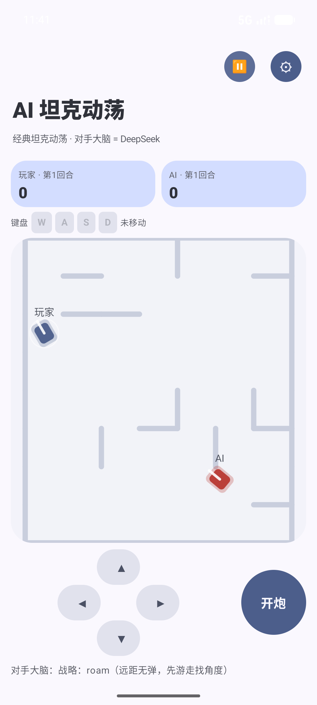

# AITank · AI 坦克动荡

经典 Tank Trouble（坦克动荡）复刻 + DeepSeek 大模型驱动的 AI 坦克对手。网页版单文件即开即玩，附安卓版。



## 这是什么

你开一辆坦克，对面是一辆由大模型实时操控的坦克。AI 不是脚本机器人——它读战局、流式输出驾驶指令、能给自己编写算法、打完还会复盘记笔记。

**忠实复刻原版手感**（参数对照开源克隆逐项校准）：

- 车速 85 px/s，弹速 1.5× 车速，弹匣 5 发
- 7×8 程序生成迷宫（随机墙 + 连通性修复），每回合不同
- 子弹墙体反弹，可反弹狙击，也会炸死自己
- 转向意图制单通道：AI 与玩家同速转向（180°/s），无瞬转外挂

**AI 的能力**：

| 能力 | 说明 |
|---|---|
| 流式混合指令 | 模型边输出 token 边执行（`{"cmd":"turn"...}`），新指令即时打断旧动作 |
| 指挥官姿态 | 每 3 秒依战局切换 engage / evade / roam |
| 反射层 | 本地毫秒级弹道预测躲避，不占模型 token |
| 自写算法 | AI 可 `set_algo` 编写条件组合算法（存 localStorage，跨局生效），与内置算法同层级调用 |
| 内置算法库 | `dodge_bullets` / `keep_distance` / `chase_and_fire` / `ricochet_fire`（反弹弹道全角搜索）/ `flank` / `roam` |
| 公开弹道 API | `predictPath` / `willHit` / `aimRicochet`，含墙体反弹模拟，AI 自写算法可直接调用 |
| 复盘学习 | 击毁后自动复盘：战报（2 秒态势快照 + 开炮预判 + 击毁详情）→ DeepSeek 产出教训 → 持久记忆跨局注入提示词 |

## 网页版（推荐入门）

```bash
cd web
python3 -m http.server 8000
# 浏览器打开 http://localhost:8000
```

或直接双击 `web/index.html`。首次使用点 ⚙ 填入 DeepSeek API key（本游戏必须配 AI：复盘驱动开局，未配 key 会停在结算画面提示配置）。

**操作**：`W/S` 前进后退，`A/D` 旋转，`空格` 开炮；`⏸` 暂停（AI 决策流同步冻结）；`🛡` 仅躲避测试模式。

AI 设置面板支持改模型（`deepseek-flash` / `deepseek-v4-pro`）与端点，接入格式为 [DeepSeek Anthropic 兼容 API](https://api-docs.deepseek.com/guides/anthropic_api)（`POST /anthropic/v1/messages`）。

## 安卓版

```bash
# Android Studio 打开本项目，或：
./gradlew :app:assembleDebug
adb install app/build/outputs/apk/debug/app-debug.apk
```

- 需 Android 8.0+（minSdk 23），无第三方依赖外的特殊权限
- AI key 在 App 内 ⚙ 设置（BuildConfig 预置编译时注入，不进源码）
- 内置 adb 调试 CLI：`adb shell am broadcast -a com.halo.daily.aitank.CLI --es cmd state`（支持 `state` / `fire` / `move:right` / `newround` / `reset` / `brain:on|off` / `map` / `memory` 等）

## 工程说明

```
web/index.html    网页版单文件（游戏 + AI + 算法库 + 复盘，约 900 行）
app/              安卓版（Kotlin + Compose，与网页版同一套玩法设计）
```

开发过程记录（分层架构对照实验、算法可编写性验证、原版速度复刻等）见各版本内注释。

## License

[MIT](LICENSE) © 2026 Halo0sama
