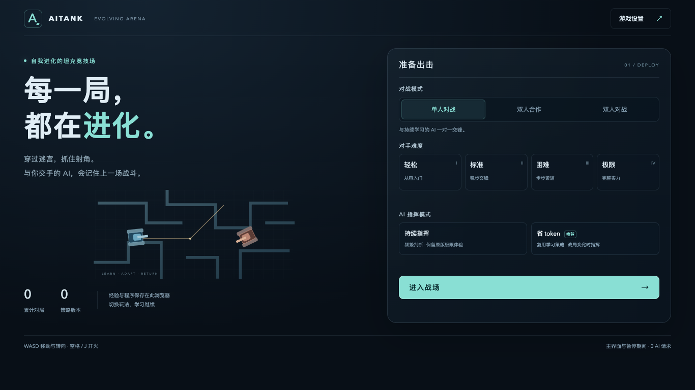

# AITank · AI 坦克动荡

经典 Tank Trouble（坦克动荡）玩法 + 大模型驱动的 AI 坦克对手，支持单人对战、同键盘双人合作和 PvP。当前维护重点是网页版，安卓版代码保留。

当前版本：**v1.1.0 · 网页版**。可从 [Releases](https://github.com/Halo0sama/AITank/releases/latest) 下载解压即用的网页包，更新内容见 [CHANGELOG](CHANGELOG.md)。



## 这是什么

你开一辆坦克，对面的大模型读取完整战局，以关闭思考的 SSE 流下达移动目标、开火意图和战术选择。本地程序完成寻路、运动预测、瞄准、紧急躲避与弹药机会评估。大模型在赛后按难度逐局或集中复盘，并能自己编写或更新条件策略、JavaScript 战术程序、独立预测器、避弹程序和火控程序。

核心循环是 **对局 → 战报 → 大模型复盘 → 更新记忆与策略 → 下一局执行 → 记录战绩**。学习保存在当前浏览器的 `localStorage`，刷新后保留。这里的“进化”是记忆与策略迭代，模型权重不变，也不保证每次改写都会提高胜率。页面显示对局数、成功复盘数、策略版本和近期 AI 战绩，学习档案可导出。

**AI 决策始终是核心**：是否拾取、选择哪个箱子、撤离或更换目标，由大模型或它编写并能更新的策略决定。本地路径、风险和弹药评分只作建议，不会擅自抢道具、替换目标或在代码未输出移动时补上追击。AI 只有选择了箱子才会拾取，普通经过不拿；玩家仍经过即拿。AI 也可明确选择内置战术或自动择敌，将该项执行授权给本地。没有指令或有效策略时等待，保留即时避弹能力，网络失败继续已有有效指令。

**待发技能威胁**：本地还会预演玩家“现在开火、转向后开火、引爆破片或启用护盾”等可能情况，考虑墙体、穿透、散射、蓄能、独立弹药和冷却。指挥官收到简要风险与走位选项，自写程序收到完整路径/区域，并可用 `api.incomingRisk`、`api.opponentShot` 自行比较。AI 可主动选择 `anticipate_attack` 委托预防机动，也可继续抢攻或等待；假设攻击不会伪装成真实来弹或强制撤退。默认预演未来 3.6 秒、只采样部分攻击方式，不能预知玩家按键，也不会揭示已隐藏的敌方地雷。

**玩法参数**：

- 玩家与极限 AI 车速 100 px/s，低档 AI 按难度削弱；普通弹速 128 px/s，同时在途最多 5 发；子弹命中或寿命结束才归还槽位，反弹不归还
- 电脑端 11×7 横向迷宫、触摸端 7×8 迷宫；每回合不同，保证格子连通
- 子弹墙体反弹，可反弹狙击，也会炸死自己
- 转向意图制单通道：极限 AI 与玩家同速转向（180°/s），低档位按难度削弱，无瞬转外挂

**AI 的能力**：

| 能力 | 说明 |
|---|---|
| 流式指挥 | `thinking: disabled`，极限档持续输出意图、约每 3 秒刷新完整战局；低档位减少请求与输出条数。单向 API 输出途中无法追加输入 |
| 目标导航 | `move_to` 下达像素坐标；本地寻路绕墙，到达后保持位置并辅助瞄准；模型不能瞬移或直接改坐标 |
| 优先级与并行动作 | 条件规则支持 `priority`、`all/any` 和动作数组；移动、转向、开火分别仲裁，紧急响应比较安全机动与战术动作 |
| 近距交战 | 指挥官可独立选择 `combat: auto/duel/evade`；贴身来弹时本地立即比较倒车、弧线机动与脱离，并抓住已有安全射角先还击；不等待下一次模型回复 |
| 弹药决策 | 区分可用弹与在途弹，估计槽位归还、已有弹道覆盖与新射击增益；用收益和成本选择开火/等待，指挥官可选择 `gunnery: auto/pressure/conserve`；没有新增强制保留弹数或射击间隔 |
| 反射层 | 模拟弹道、转向与碰撞，以存活为先，同时评估近距射击机会；安全有效的战术动作可替代自写避弹的逃跑方向；短时保持方向防止颤抖，威胁解除后继续原目标 |
| 自写程序 | 复盘可 `set_algo` 写条件策略、`set_code` 写 JavaScript 战术、`set_predictor` 写预测算法、`set_reflex` 写避弹程序、`set_gunnery` 写独立火控；场上只下达指挥意图 |
| 本地预测器 | 接收最近运动历史，约 10Hz 本地运行；模型可改写回归、转弯、滤波等逻辑，不用每次通过大模型计算预测坐标 |
| 代码隔离 | 代码在无主页面访问权限的隔离 Worker 中执行，40ms 超时停止；预测器不能驾驶坦克。自写避弹先经过空地、窄通道与贴身来弹物理回放，实战危险输出会被否决并切回本地规划器 |
| 内置算法库 | `dodge_bullets` / `keep_distance` / `chase_and_fire` / `ricochet_fire`（反弹弹道全角搜索）/ `flank` / `roam` |
| 弹道预测 | 本地计算反弹与自伤风险，搜索结果短期缓存；大模型通过战术算法使用这些能力 |
| 复盘学习 | 各类程序跨刷新保存；记录实际控制者、位移、堵塞、换向、逐发射角和弹量、重复覆盖、空弹接近与故障，让下一次复盘能针对执行结果修代码 |
| 异常恢复 | 暂停、设置、结算会取消控制流；复盘失败或 20 秒超时后沿用已保存策略继续 |

## 网页版（推荐入门）

```bash
cd web
python3 -m http.server 8000 --bind 127.0.0.1
# 浏览器打开 http://127.0.0.1:8000/?paused=1
```

macOS 可以从项目根目录运行 `/usr/bin/python3 tools/macos/install.py`，安装 `/Applications/AI 坦克动荡.app`。双击应用会自动启动或复用本地服务，再通过 Edge 打开上述地址，默认暂停。保持同一浏览器与地址即可沿用已有学习存档；移动项目目录后重新运行安装脚本。

人机对战首次使用点击「设置 → AI 接口」，填写自己的 API Key。默认接口为 DeepSeek 的 Anthropic 兼容 `messages` API，也可修改模型和完整接口地址。未配置 Key 时人机对局等待；PvP 无需 Key 即可游玩。

打开网页或 Applications 中的应用先进入主界面，可直接选择玩法、难度与 AI 指挥模式，查看当前浏览器的累计对局与策略版本。点击「进入战场」才开始模拟与 AI 请求；「返回主界面」暂停当前对局、取消指挥和复盘，之后可继续。未配置 API 时进入接口设置，PvP 可直接开始。

难度与省 token 现在独立选择。**极限 + 持续指挥保留原来的最高难度、实时反应、指挥频率与输出预算**；既有选择默认仍为持续指挥，学习程序不会重写或清空。低档位除了反应延迟，还实际削弱 AI 车速和转速；玩家始终为 100 px/s、180°/s。

| 难度 | AI 车速 / 转速 | 本地重新判断 | 持续指挥间隔 | 集中复盘 | 指挥 / 复盘输出上限 |
|---|---|---|---|---|---|
| 轻松 | 60 px/s / 108°/s | 0.45 秒 | 15 秒 | 每 5 局 | 256 / 2400 token |
| 标准 | 78 px/s / 140.4°/s | 0.22 秒 | 8 秒 | 每 3 局 | 384 / 2800 token |
| 困难 | 90 px/s / 162°/s | 0.10 秒 | 5 秒 | 每 2 局 | 640 / 3200 token |
| 极限 | 100 px/s / 180°/s | 每帧 | 约 3 秒 | 每局 | 1024 / 4000 token |

**极限 + 省 token** 以复用已学策略保留战力：数值、本地策略、预测、避弹与火控运行频率不削弱。战局发生资源、技能、存活、视线/近距区间、抵达/受阻或故障等变化时，最短 6 秒补充一次模型指挥；无变化最多 20 秒检查一次。每次最多 4 条完整指令、384 token 输出，完整战场坐标和弹体全部保留，用元组与紧凑提示减少重复上下文；每 3 局集中复盘，仍保留 4000 token 程序输出空间。没有有效策略时等待模型，不新增本地代决策，模型可 `keep` 沿用或 `stop` 放弃当前行动。它以接近极限战力为目标，减少临场指挥可能影响表现，不保证与持续指挥胜率相同。

省 token 可搭配其他难度：指挥最短间隔取本档间隔与 6 秒中的较大值，复盘周期至少 3 局，输出预算不高于本档。提示中的输出上限不是实际消耗；当前受控 40 弹、双玩家快照的请求字符量约减少 44%，不能直接换算为 API 计费。低档位的碰撞与模拟仍逐帧运行，不增加强制留弹、额外禁射间隔或空弹必撤。

待复盘的最近 5 局完整战报在本地保存，刷新与复盘失败后保留；复盘成功才移出队列。每局记录难度、数值版本、指挥模式及中途变化，近期胜率按相同规则筛选；旧战绩、教训与源码仍保留。主界面、暂停和设置不发起 AI 请求，并取消进行中的指挥/复盘，继续后重试待处理复盘；已产生的 token 不会撤销。

API Key 默认只保留在本次页面会话；勾选「在此浏览器保存 API Key」后才写入本地存储。学习档案导出不包含 API 配置。旧版已保存的记忆、有效自写策略和配置会尝试恢复。

在「设置 → 对局与操作」中选择单人、双人合作或双人对战 PvP，保存后应用。切换模式会重新开局，不把中止的这一局记为输赢；API 配置、难度和已有学习成果保留。取消设置不会改变模式或难度。

| 玩家 | 前进 / 后退 | 左转 / 右转 | 开火 |
|---|---|---|---|
| P1 · 蓝色 | `W` / `S` | `A` / `D` | `空格` 或 `J` |
| P2 · 绿色 | `P` / `;` | `L` / `'` | `Enter` |

P2 使用键盘上的分号与单引号物理键；中文标点或 Shift 不改变这些按键的方向。P1 也可使用方向键。`Esc` 暂停或继续；P 键在双人模式专用于 P2 前进，单人模式仍兼容原来的 P 暂停。切换窗口会自动暂停，设置面板打开时对局停止，输入配置不会操控坦克。小屏保留 P1 的触摸按钮，双人模式使用同一副实体键盘。调试工具中的仅躲避对局不计入学习。

**合作规则**：两名玩家共用人类方比分，分别拥有 5 个在途弹槽位和独立冷却；队友子弹和自己的反弹弹都能造成伤害。第一名玩家阵亡后继续战斗，下一局才复活；阵亡者已发出的子弹仍有效。AI 被击毁即判人类方胜利，AI 存活且全部人类阵亡才判 AI 胜利。同一模拟帧内 AI 与最后一名人类同时被击毁，优先判人类方胜利，结算只发生一次。

**PvP 规则**：场上只有 P1 和 P2，击毁对手即胜，自伤也会判负；同一模拟帧双方同时阵亡算平局。双方使用相同物理、武器和独立弹槽，每局结算后自动重开。PvP 比分单独保存，不请求模型、不复盘，也不计入 AI 战绩或改变已有学习。

### 武器道具

指挥官、赛后教练及本地自写程序共享全部十种武器的机制定义，包括独立弹药、真实速度/寿命与路径射程、散射、蓄能、反弹、穿墙、自伤、护盾、布雷和二次引爆。`api.shot` / `api.willHit` 按手持武器计算，`api.weaponAim()` 提供本地射角建议；开火时机和战术仍由 AI 选择，建议不会自动代替决策。机炮停止授权后会停止续射。已有学习源码保留，由教练基于逐发武器证据更新。


默认随机刷新道具箱，玩家经过即可拾取，AI 需先由指挥官或学习策略选择箱子。在「设置 → 对局与操作」关闭「允许 AI 拾取道具」，即可进行 AI 禁用拾取的单人或合作对局：玩家照常拾取，AI 仍能使用切换前已持有的道具，并识别和应对特殊攻击。该规则独立保存，切换回允许时恢复拾取。加入激光、双管炮、霰弹枪、追踪导弹、隐形地雷、护盾，以及旧版加特林、破片炸弹、死亡射线和遥控导弹。机制参考原作玩家的 [武器指南](https://sv4t.weebly.com/beginners-guide.html) 与 [使用技巧](https://sv4t.weebly.com/weaponpower-up-tips.html)，射速、射程和刷新节奏按本作地图调整；采用一个待命道具槽，拾取后沿用开火键主动释放；已启用的护盾可与新武器同时生效。

| 武器图形与名称 | 拾取后的操作与效果 |
|---|---|
| 激光 · 光束发射器 | 高速反弹，玩家有瞄准线；开火短暂锁车，只有移动的弹头造成伤害 |
| 双管炮 · 双炮管 | 左右炮管交替发射，10 发短程弹 |
| 霰弹枪 · 扇形散弹 | 3 次开火，每次 20 枚短程散弹 |
| 追踪导弹 · 导弹与目标 | 发射两秒后追最近的存活坦克，会换目标，也会追自己 |
| 隐形地雷 · 地雷轮廓 | 可布 3 枚，放在车后；就绪后隐藏，踩中后离开引爆 |
| 反弹护盾 · 盾牌 | 拾取待命，按开火后生效 6 秒；盾内反弹回来的自己的子弹仍可能自伤 |
| 加特林 · 多管机炮 | 按住开火，蓄转后连续发射，松开停止 |
| 破片炸弹 · 手雷 | 再按一次开火引爆，超时或碰车也会爆裂；破片有自伤和友伤 |
| 死亡射线 · 穿透能量束 | 定身蓄能，穿内部墙体及多个坦克，到场地边缘停止 |
| 遥控导弹 · 导弹与无线电波 | 沿用左右转向键操舵，导弹存续期间车体锁定 |

全部沿用原开火键，特殊弹量在侧栏显示，用尽后恢复普通炮；普通在途弹继续飞行并独立归还原来的 5 个槽位。AI 能读取武器、剩余弹量、护盾、道具和全部可见弹体位置，可下达拾取指令，也可在复盘中更新相关策略、避弹与火控。隐形的敌方地雷不会泄露给 AI。

追踪、碰撞、特殊弹预测和遥控操舵均在本地运行，不增加逐帧 API 请求；指挥快照会增加必要的武器信息，实际 token 用量仍取决于战局。可在「设置 → 对局与操作」关闭道具，保留已有学习。

### 图形与音效

十种道具使用不同的武器轮廓图标和中文名称，不再用字母缩写；设置中的道具说明沿用相同图形。坦克履带增加钢灰边缘和清晰链节，滚动取自实际位移与旋转，支持倒车和两侧反向原地转向，撞墙、停止及暂停时冻结；减少动态可关闭滚动。

「设置 → 画面与特效 → 游戏音效」可开关音效、调节音量并逐项试听，取消恢复原值，保存后跨刷新保留。全套声音已替换为从 Freesound CC0 素材制作的 26 个轻街机采样短音频（约 109 KiB）：普通炮、双管炮、机炮、霰弹、激光、追踪/遥控导弹、破片弹、地雷、死亡射线与蓄能各有独立声音，另有反弹、爆炸、护盾、拾取、界面和胜负提示。炮击采用弹性短 pop，爆炸采用电子碎爆，去掉写实枪炮和柴油轰鸣；实际行驶与转向仅播放很轻的运动细响，撞墙静止、死亡、暂停或返回主界面会停止。

首次点击或键盘操作后从游戏本地预载音频，用 Web Audio 播放，不连接素材站或模型接口；未准备好的战斗声音直接丢弃，关闭的试听不会在加载完成后补播。最多 12 路并发，按声音种类限制叠音，保留高优先级爆炸/射线，统一限幅与左右声像。音效独立于画质，不改变物理、AI 决策或游戏随机数。来源、作者和授权见 [音效鸣谢](web/assets/audio/CREDITS.md)，裁剪/混音配方见 `tools/audio/recipes.json`，可用 `python3 tools/audio/build.py <素材目录>` 复现。

### 画面与特效

「设置 → 画面与特效」提供关闭、流畅、均衡、精致、极致五档，调节粒子密度、光晕与尾迹长度；电脑默认精致，触摸设备默认均衡。炮口火光、后坐、反弹火花、导弹尾焰、分层爆炸、余烬、护盾折光和道具拾取均有独立表现。强度可调，柔光、尾迹、环境细节及镜头震动可单独开关；震动默认关闭，减少动态选项首次遵循系统偏好。

画面可在设置中即时预览，保存后跨刷新保留；取消或 Esc 恢复原设置。关闭特效仍保留弹头、激光、护盾、蓄能与地雷等必要战斗提示。画质不改变物理、弹药、随机地图或 AI 强度，不产生模型请求。学习管理、算法查看与导出统一放在「设置 → 学习与程序」，键位和调试工具在「对局与操作」。

AI 指挥与本地程序都能看到两名玩家的独立位置、弹药、生存状态和轨迹；`enemy` 保持表示当前目标，新增 `enemies` 列出所有玩家。指挥官可指定 `target`，本地也可自行择敌；目标阵亡后自动切换到幸存者，旧预测和瞄准缓存同时失效。单人和合作共用学习成果，战绩记录模式、每名玩家的阵亡原因与友伤归属，近期胜率按同模式、同难度比较。

接入格式见 [DeepSeek Anthropic 兼容 API](https://api-docs.deepseek.com/guides/anthropic_api)。网页直接向所配置端点发请求，端点需要允许浏览器跨域访问；推荐用上面的本地 HTTP 服务打开。

对战规则与指挥协议见 [网页版架构](web/ARCHITECTURE.md)，本版验证见 [发布检查](docs/VALIDATION.md)。运行测试：

```bash
cd web
npm ci
npm test
npx playwright install chromium
npm run test:browser
```

浏览器测试使用本地模拟 API，不消耗真实账号额度。也可通过 `PLAYWRIGHT_EXECUTABLE_PATH` 指定已安装的 Chromium 浏览器。运行游戏本身无需安装 Node 或 npm 依赖。

## 安卓版

```bash
# Android Studio 打开本项目，或：
./gradlew :app:assembleDebug
adb install app/build/outputs/apk/debug/app-debug.apk
```

- 需 Android 8.0+（minSdk 23），无第三方依赖外的特殊权限
- AI key 在 App 内 ⚙ 设置（BuildConfig 预置编译时注入，不进源码）
- 内置 adb 调试 CLI：`adb shell am broadcast -a com.halo.daily.aitank.CLI --es cmd state`（支持 `state` / `fire` / `move:right` / `newround` / `reset` / `brain:on|off` / `map` / `memory` 等）

## 工程说明

```
web/index.html    网页游戏、战术执行、复盘与界面
web/ai-core.js    流式协议解析、策略校验与学习数据处理
web/ai-programs.js 隔离算法运行器
web/ai-sandbox.html 无主页面权限的 Worker 宿主
web/skill-registry.js 原创技能定义与生命周期接口
web/custom-skills.js 原创技能注册入口（默认留空）
web/weapons.js   道具、特殊武器与共享弹体物理/防御预测
web/effects.js   独立视觉粒子、柔光、尾迹与质量预算
web/game.css     游戏 HUD 与统一设置界面
web/ai-dodge.js  本地避弹与物理回放
web/ai-ammo.js   在途覆盖、弹药机会成本与火控评估
web/ai-tactics.js 路径/道具收益、空弹机动与多弹逃逸路线覆盖
web/tests/       协议测试与浏览器回归测试
app/              安卓版（Kotlin + Compose，与网页版同一套玩法设计）
```

网页版仍使用原有 Canvas 游戏，不依赖前端框架或在线资源。

原创技能扩展见 [web/SKILLS.md](web/SKILLS.md)：注册后统一进入拾取、独立弹药、持续增益、危险预测、渲染、AI 说明和复盘。游戏规则由本地可信代码维护，AI 仍通过复盘改写隔离执行的战术算法。手动真实 API 验收页为 `/tests/live-api.html`，只在点击开始后发起最多三次请求，使用隔离对局并自动暂停。

网页版的 `use_weapon` 可由 AI 明确选择，按当前武器射程/回弹风险交战，并比较护盾时机与布雷位置。加特林支持持续输入，也可通过 `trigger` 指令点射、长按和松开。死亡射线为穿内部墙、轻微弯曲的连续光柱；霰弹风险检查覆盖整组弹丸。开发用武器策略校准页 `/tests/weapon-mastery.html` 只在点击后调用真实模型，测试结束暂停；应用验证结果需另存新策略，原学习保留。

## License

[MIT](LICENSE) © 2026 Halo0sama
