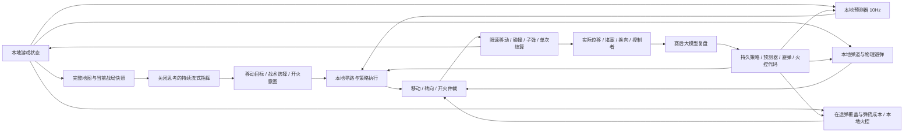

# 网页对战与 AI 分工

大模型负责参与指挥和编写可复用算法。计算位置、碰撞、预测弹道、执行移动和开火的唯一权威是本地游戏模拟。模型不能直接改坐标、速度、角度或比分。



## 指挥官的输入与输出

每次请求携带完整地图与当时的真实状态：场地尺寸、格子大小、所有坦克的像素位置、朝向、生存状态、弹药、冷却、比分，以及所有子弹的位置、速度、归属和剩余寿命。还包含当前移动目标、本地算出的预测点、威胁与执行反馈。`self` 是红色 AI，`enemy` 是当前攻击目标，`enemies` 是全部人类玩家（P/P2），含阵亡状态。`targetId` 标记当前目标。没有隐藏玩家未来按键。

位置以左上角为原点，x 向右、y 向下；距离用像素，1 格为 100 像素。朝向在战局快照里用角度，算法运行器里用弧度。地图中 `#` 是墙、`E` 是 AI、`A` 是 P1、`C` 是 P2、`B` 是子弹，阵亡坦克不标记。格子坐标与像素坐标通过 `cellSize` 换算。

指挥请求始终设置 `stream: true`、`thinking: {type: "disabled"}`。收到每条完整 JSON 后即提交意图。持续指挥模式的极限档保留原逻辑：每 3 秒取消旧流并用新快照重启，流提前结束也会重连。其他档位按 5 / 8 / 15 秒的最小请求间隔执行，每次最多接收 6 / 4 / 3 条有效指令；提前结束也不会跳过间隔。单向 HTTP 输出流无法中途接收新输入，所以模型看到的是请求时刻的最新战局，本地负责后续执行。

```json
{"cmd":"move_to","x":650,"y":250}
{"cmd":"combat","mode":"duel"}
{"cmd":"gunnery","mode":"conserve"}
{"cmd":"fire"}
{"cmd":"algo","name":"learned_tactics"}
{"cmd":"posture","mode":"evade"}
{"cmd":"stop"}
```

移动意图只有一个当前目标，不排队。新目标、战术或姿态替换普通移动计划；开火意图不取消移动。重复目标不会加速或瞬移。可带 `round_id`，不属于当前回合的命令拒绝。场上不接受代码写入；即使命令夹带 `set_code` 等元操作，也会剔除它们。

`combat` 独立选择紧急交战偏好，保留导航和当前战术：`auto` 在敌方近距突袭时立即比较机动还击与脱离，`duel` 优先保留可用射角进行近距交战，`evade` 优先脱离弹道。选择持续到替换或下一局；每局初始为 `auto`。姿态 `engage` 同时选择 `duel`，姿态 `evade` 同时选择脱离偏好。指挥官收到当前偏好、实际响应和能否躲开当前来弹的评估，后续可以调整意图。

`gunnery` 独立调整火控偏好：`auto` 比较新增射击机会与等待，`pressure` 更愿意投入弹药压制，`conserve` 提高槽位机会成本。这些是评分偏好，没有新增强制保留弹数、全局禁射间隔或空弹强撤退规则。显式 `cmd:fire` 和战术的直接 `fire` 可主动越过默认收益选择，自写火控也可选择与默认评分不同的行动；既有物理冷却、容量和弹道安全边界保持有效。

## 同键盘双人合作

`aitank_mode` 保存 solo/coop/pvp 偏好，默认单人。模式切换中止当前回合并清理两组按键、子弹、短期运行器和旧请求，不计弃局输赢，不清空学习及配置。三辆坦克使用唯一 `id`（P、P2、E），寻路中的虚拟车体也继承 ID，碰撞时据此排除自身；每个存活车体都会阻挡其他车体。

P1 使用 WASD 和空格/J；P2 用 P/L/分号/单引号对应前进/左转/后退/右转，Enter 开火。标点优先按 `KeyboardEvent.code` 识别，兼容中文或 Shift 标点。合作模式 P 不暂停，Esc 统一暂停。两组输入在失焦、暂停、设置与开新局时一起清除，阵亡车体不能驾驶或开火。

子弹归属 `own` 为 E/P/P2，指挥快照另给出明确的 `ownerId`。每个发射者独立计算容量与冷却，命中或到期只归还该发射者的槽位；阵亡者的在途弹仍保留。所有存活坦克都能被任意归属子弹击毁，包括自己和队友。

每帧先处理全部命中和归属，再结算一次：AI 阵亡优先判人类方胜；AI 存活且全部人类阵亡才判 AI 胜。部分人类阵亡不停止游戏、不复盘、不加比分，剩余玩家和 AI 继续操作；下一局两名玩家复活。`eliminations` 逐人记录阵亡时间、弹源、自伤和友伤，教练不能把友伤算成 AI 击杀。人类方比分共用原 P.score，累计学习计数继续按完整对局统计。

默认保持当前存活目标；只有指挥官以 target:auto 授权后，本地择敌才比较距离、视线与弹药，以迟滞避免反复换目标；`{"cmd":"target","id":"P2"}` 可锁定指定存活目标，`id:"auto"` 恢复本地择敌。目标阵亡时自动解除锁定。切换目标保留导航与战术，重置预测、瞄准、短期代码记忆及相关缓存，旧运行器结果不能串到另一名玩家。`state.enemy` 兼容既有程序，表示选定目标；`state.enemies` 为所有玩家各自的状态和独立历史。避弹推演考虑两个对手的实体，火控识别两名玩家的弹药及所有来弹。

学习程序跨模式共享，战绩、战报队列和导出记录 mode，复盘提供分别标记的两组玩家轨迹；近期胜率只统计同模式、同档位且没有中途混档的对局。旧档案未标模式时按单人处理。

## 同键盘 PvP 与 AI 拾取规则

PvP 使用相同的两组键位，`allTanks()` 只返回 P/P2，E 不生成；两人均可在没有 API Key 时操作。普通及特殊武器继续使用共享物理和命中逻辑，一帧全部命中处理完后结算：一名幸存者获胜，全部阵亡则平局。PvP 独立比分保存在 `aitank_pvp_scores`，不改变 AI 比分、学习回合数、历史或待复盘队列。指挥、复盘、学习代码入口及晚到响应均按模式和回合门禁拒绝，PvP 不产生模型请求；切回人机后保留原有学习。

`aitank_ai_powerups` 独立保存 AI 是否允许拾取，默认允许。`weaponWorld.canPickup` 在武器系统的统一 `canEquip` 入口拒绝 E 拾取所有内置及原创道具，物理经过箱子、直接装备和战术拾取均遵守同一规则，P/P2 不受影响。关闭时取消已经标记的拾取导航，保留普通显式导航、已持有武器和已发射弹体。局势快照及指挥提示携带禁用规则，相关战绩标记 `aiPowerups`，近期战绩按相同拾取规则比较。PvP 设置中此项和 AI 难度暂不可选，原偏好保留。

## 执行与仲裁

### 武器与共享弹体物理

`weapons.js` 管理十种武器、道具箱、地雷、护盾、蓄能和遥控锁车，普通炮与特殊弹体都由同一个更新器移动和判定命中。高速弹按最多约 4px 的子步检查墙体、护盾和车体，弹体半径由种类决定；死亡射线穿内部墙体和车体，到外边界停止。激光的尾迹只作显示。整帧命中先记录，再使用同一套合作结算规则决定输赢。

普通弹保留五个在途槽位，特殊弹标记 `slot:false`，使用武器自身的有限弹量；特殊弹销毁不会归还或扣减普通槽位。护盾反射不转移弹源，反射时也不归还普通槽位。破片、地雷、遥控弹和阵亡者遗留弹仍遵循友伤、自伤和弹源归属。每局清除所有武器、护盾和遥控状态；关闭道具只清除特殊状态，保留普通在途弹及学习数据。

AI 收到 `self.weapon` 和各玩家武器、护盾、锁定状态，`weapons.pickups` 是可拾取箱子。`{"cmd":"pickup","id":箱子ID}` 导航到箱子，`collect_powerup` 战术选择附近兼容道具。它们与 `move_to` 共用寻路和紧急响应；模型仍可自由选择其他目标。所有武器共用 `fire`，本地控制遥控弹的转弯；显式开火与自写火控仍可覆盖默认机会评分，不新增强制留弹规则。条件 `ammo_ready` 在持械时检查当前武器，普通槽位全部占用也可使用特殊弹药。

特殊弹在 API 快照中按弹源和种类分组为元组，保留每一个弹体的实时坐标、速度和寿命，减少重复字段；普通弹格式兼容旧版。弹药报告仅摘要部分覆盖评分，并报告总数量，不裁剪战场坐标。坦克的武器字段不在道具对象中重复发送。快照和沙箱仅包含可观察的地雷：自己的、尚未隐藏的或已触发的地雷。

避弹程序的 `state.ballistics` 为本地共享物理产生的短期预测帧，覆盖追踪转弯、反射、待发蓄能射线和定时破片，约 0.08 秒缓存一次。预测保守地忽略未来车体对弹体的消耗，追踪目标以当前位置推演，无法知道未来按键或遥控输入；不是必然命中的预言。`state.weapons` 提供可观察地雷，已踩雷时可比较停住射击和离开的代价。预测器、避弹与火控依然可由复盘更新，武器物理规则不向生成代码开放。道具不创建额外模型请求，已有难度档位继续控制指挥和复盘频率。

`execution.weapons` 记录拾取、各类开火次数、引爆与反射，`eliminations.weapon` 记录致命弹种；开火次数按一次扳机统计，不把霰弹的 20 枚弹丸记成 20 次开火。版本 7 学习导出包含道具偏好和这些战报，仍排除 API 配置。

### 难度与动作仲裁

`DIFFICULTIES` 控制 AI 的数值与反应：轻松、标准、困难的车速/转速分别为基础值的 60% / 78% / 90%，极限 100%。玩家保持 100px/s 与 180°/s，AI 物理执行使用 `tankMotion(E)`。`programSnapshot.constants` 中 tankSpeed/rotationSpeed 为 self 实际值，兼容旧自写程序；`self.motion`、`enemy.motion`、`enemies[].motion` 分别给出各自实际参数。避弹推演使用 self 常量，敌方可行运动、武器攻击的转向时间和 Worker 的 opponentShot 使用对应 actor 参数，避免误以为玩家也被削弱。已有自写源码不变，教练可依据新数值改进。

低档位仍以 0.45 / 0.22 / 0.10 秒间隔重新判断，两次判断间逐帧执行上一组动作；输出有效期涵盖本档反应延迟。普通弹容量、炮速、物理冷却、特殊武器参数均未修改，不增加硬性留弹或禁射规则。极限 + continuous 保留原逐帧反应、约3秒持续流式指挥、1024/4000 token 预算及逐局复盘。

`aitank_commander_mode` 独立保存 continuous/economy。economy 只优化请求调度、输入重复和复盘批次，不选择任何策略或目标。`ai-budget.js` 比较资源、武器/护盾、存活、可见道具、目标、到达/受阻、故障、紧急状态和距离区间的标记；新局立即请求，变化最短6秒补充，无变化20秒保底检查，较低档原有最小请求间隔仍生效。调度器没有动作输出权。没有有效策略不会补上本地行为；`keep` 是模型明确沿用当前决定，不创建行为。省 token 模式保持本档全部物理与本地运行频率，极限时每次最多4条指挥、384 token，集中3局复盘，复盘仍有4000 token。无法保证减少临场模型参与后胜率完全相同。

紧凑输入保留全部坦克实时状态、完整地图、每一个普通与特殊弹体（含光柱几何），武器定义、可见地雷与技能参数；以列名+元组消除弹体重复字段，省去重复的本地建议评分和说明，不裁剪弹体。完整的本地 state 仍提供给自写代码。两种模式均关闭 thinking，旧回合、暂停、主界面及模式切换前的响应拒绝执行。明确的策略 fire:false 同样约束近战还击，紧急运动仍可执行，指挥官后续显式 fire 仍可授权。

每局记录 balanceVersion=2、commander 和 commanders；中途改变难度/指挥模式有时间标记。开始模拟前在菜单选择的参数只记录最终值；战绩按数值版本（低档）、难度、指挥模式、玩法和拾取规则筛选，旧累计数和源码保留。学习导出版本9新增这些字段。

启动进入 DOM 主界面，homeOpen/paused 同时阻止 advance、fire、canControl 和 doReflect。设置可从主界面进入，保存后返回主界面，只有点击进入战场才恢复；返回主界面调用 stopStream/suspendReview 并清除输入，保留当前回合与待复盘战报。焦点回到可用按钮，游戏区域与设置分别使用 inert，手机采用可滚动单栏，桌面保护战场区域。

每帧只对 AI 做一次移动、一次有限速转向、一次受冷却和弹匣限制的射击。先检查威胁，再收集策略意图，最后应用实际物理。策略中的 `priority` 为 0–100，数值越大越优先；`do` 数组允许同帧并行，`all`/`any` 可以组合距离、弹量、对齐和威胁条件。

紧急响应保留原导航目标或策略。威胁解除后自然恢复，不用等待模型再发一条“继续”。本地规划器模拟子弹反弹、实际限速转向、墙壁与车体碰撞，比较前进、倒车和弧线机动。近距交战使用 1.3 秒视距，避免将短期没有命中的直线倒车误判为能甩掉子弹；评分首先区分能存活的动作，再考虑净位移、射角及开火机会。已有效的方向短时保持，避免反复换向。自写避弹是候选动作，安全有效的普通战术可以保留移动控制权；安全但不适合当前交战的逃跑动作可被替代，这不算程序故障。

近距有弹药时，若当前炮口已有安全射线，先在该角度开炮，再应用本帧限速转向与移动；冷却确保每帧最多一炮。后续保持安全射角时继续机动还击。炮管与车体同向，不提供独立炮塔或横向平移。若所有候选都无法躲开来弹，选择尽量延后命中的动作并争取合法还击，不保证必然脱险。普通 stop 不关闭紧急响应；`evade` 不会自动发起近距反击，但仍可执行其他安全开火意图。

`move_to` 用本地迷宫寻路与坦克净空检测；墙内或被坦克占据的目标纠正到最近可用格子中心，越界/非法数值拒绝。路径受其他坦克阻挡时等待或重新选择路线，并报告执行状态。抵达后保持位置，允许本地预测辅助瞄准。玩家及极限AI车速100px/s、转向180°/s，低档AI使用上述数值比例，倒车速度为各自前进速度的0.65。坦克实体不能重叠，墙体不能穿越。

## 预测器与学习

默认预测基于本地运动观测，在约 10Hz 更新；模型不会逐帧计算未来坐标。复盘时可以通过 `set_predictor` 写或更新一个同步 JavaScript 函数体，接收 `state`、`memory`、`api`。它独立常驻，切换战术不停止它。

```javascript
const samples = state.enemy.history;
const point = api.predictEnemy(state.horizon, "turn");
return { prediction: point };
```

这个示例使用基础辅助函数。模型也可以根据原始 `{x,y,a,time}` 样本自行实现加权速度估计、回归、转弯预测、滤波等算法。预测器仅能返回 `prediction` 与可选 JSON `memory`，不能返回驾驶或开火动作。初始预测器由复盘教练编写，之后依据实际样本与战报更新。突然改变按键无法被提前知道。

`set_algo` 用于可读的条件与优先级规则；`set_code` 可编写更复杂的本地战术。代码在 `sandbox="allow-scripts"` 的独立来源 iframe 所创建的 Worker 中运行，不获得 API Key、DOM 或存档；网络原语禁用，并使用 CSP 禁止网络访问。编译与输出先验证，每次执行超出 40ms 则终止，游戏线程继续运行。参考 [MDN iframe sandbox](https://developer.mozilla.org/en-US/docs/Web/HTML/Reference/Elements/iframe#sandbox) 与 [Web Workers](https://developer.mozilla.org/en-US/docs/Web/API/Web_Workers_API/Using_web_workers)。

`set_reflex` 允许赛后教练直接编写或更新独立避弹 JavaScript。它接收最近自身位置与控制样本、实时战局、指挥官交战偏好、执行统计和本地规划器建议，约 10Hz 在同一隔离运行器内计算 `move`、`turn` 与可选 `fire`。候选必须先在空地、窄通道和贴身来弹的连续物理回放中存活、产生足够净位移且不过度换向，才会替换旧版本。实战输出会与本地机动和战术候选比较；连续危险输出或实际出现颤抖、堵塞，则停用自写程序并记录原因供下一次复盘。内置、学习程序和战术的控制时间分别记录为 `native`、`learned:<名称>` 和 `tactic:<名称>`。

每局保存紧急避弹的实际接管时长、净位移相关样本、堵塞时长、换向次数、被否决动作、控制者和故障；另记机动交战时长、无法躲开的危险时长、安全还击次数和普通战术参与紧急控制的时长。教练下一局会看到这些数据以及带实际响应类型的运动轨迹，因此能判断“发出 move”有没有真的走出位置、逃跑是否比交战合适。长期学习保存记忆、策略、预测器、避弹、火控的源码和战绩；运行器的短期 memory 随回合或程序切换重置。版本标记不代表更强。旧档案缺少执行信息，不能据此反推出每局唯一执行的程序。

## 弹药与独立火控

容量 5 指最多五个子弹同时在场。`ammo` 是可用槽位，`inFlight` 是仍在场的子弹；命中任一坦克或寿命结束归还一个槽位，没有自动装满弹匣的换弹阶段。每枚子弹有发射时间、ID 和剩余寿命。输入给指挥官和本地代码的 `ammunition` 包含双方资源、预计下一槽位归还、最早寿命结束、已有弹道覆盖与压制/威胁；预测归还可能随运动和命中改变，不能当作固定倒计时。

默认火控在本地预测现有和候选弹道，估计新增命中机会、同路重复覆盖和占用槽位的成本。自动导航、追击及近距还击以收益评分选择开火或等待；机会好时可以投入最后一弹，压制偏好可以齐射。默认追击另外比较推进、停留与倒车的资源风险；明确导航目标仍由指挥官决定，空弹不会强制取消目标或限制驾驶。所有这些计算在本地进行，不逐发请求大模型。

复盘可 `set_gunnery={name,desc,code}` 写一个独立火控函数体，收到 `state.ammunition`、`state.gunnery.current` 的各项收益/成本和 `approach` 建议；同步返回 `{fire:boolean,memory:可选JSON}`。程序与预测器、战术及避弹独立保存、约 10Hz 隔离运行，可以自写评分或选择压制，不要求它服从默认分数；不获得移动或改坐标权限。超时与无效输出回退到默认火控。指挥官的显式开火意图依然可主动发射。

逐发记录实际发射时间、射角、发射前后可用弹、自动/指挥/学习火控来源和重复覆盖；另统计实际等待、空弹时长、空弹接近时长与归还槽位数，自身轨迹带双方弹量。当前局的详细证据传给复盘，历史局只发送统计摘要，导出仍保留逐发记录。旧档案没有这些证据，不能仅由复盘文字认定某一次连射无意义或编造其间隔。

## 视觉层与统一设置

`effects.js` 是独立 Canvas 2D 视觉层，负责炮口闪光、后坐、反弹火花、尾迹、导弹尾焰、爆炸、拾取和护盾命中反馈。使用独立伪随机数与视觉时钟，读取坦克和弹体状态但不写入；绘制偏移与后坐仅用于画笔，不修改实体位置。特殊武器的实际碰撞通过可选 `visual` 回调传递反弹位置，预测、瞄准和防御回放不会触发该回调。特效状态不进入模型快照或学习档案。

关闭、流畅、均衡、精致、极致分别限制粒子、同时冲击波和每枚弹体的尾迹采样量；粒子上限为 0 / 70 / 180 / 360 / 620，尾迹最多记录 220 枚弹体。柔光复用按颜色缓存的径向纹理，避免逐粒子使用阴影模糊；尾迹和粒子到期回收，开新局清空。关闭或强度为零时销毁装饰效果，核心弹头、光束、护盾、蓄能提示与可见地雷由战斗渲染器继续绘制。

视觉时钟仅在对局或回合间隔的有效更新中前进，暂停、失焦与设置打开时冻结。默认关闭镜头震动；减少动态时禁止震动和环境浮动，并降低粒子扩散量。首次载入遵循系统减少动态偏好，用户保存后沿用明确选择。电脑默认精致，触摸设备默认均衡。

设置整合为画面、对局、AI 接口与学习四组，战场侧栏只保留实时状态及暂停/设置入口。DOM 对话框保留焦点、限制 Tab 范围并将背景设为 inert；打开时取消指挥和复盘请求，继续沿用原有暂停语义。所有可编辑设置保存后应用；画质可以预览，取消或 Esc 恢复原视觉配置，模式与难度草稿不会生效。保存模式变更才重新开局，学习管理及调试工具属于明确的立即动作。图形偏好独立保存在 `aitank_visuals`，不影响 API 配置与学习数据。

## 对局生命周期

原创技能通过 `skill-registry.js` 注册，由 `weapons.js` 调用生命周期、弹体制导、额外危险预测与绘制钩子；`custom-skills.js` 是预留的项目入口，默认没有额外技能。声明式弹体沿用统一物理、友伤和槽位归属；持续增益使用游戏时钟并在过期、死亡或重新开局清理。元数据只读，内置 ID 不可覆盖。预测和绘制取得状态副本，装饰层不修改模拟。复杂区域伤害的作者必须同时实现一致的预测。详细契约与示例见 [SKILLS.md](SKILLS.md)。

指挥和本地程序只接收场上相关技能的数值与效果说明；集中复盘还补充该批历史局实际拾取或使用的技能定义。火控可读取独立容量与剩余弹量，持续增益进入自身和敌方快照。注册回调属于可信项目代码；模型生成代码不取得注册或修改物理规则的权限。

暂停、设置面板、失焦和结算都会阻止游戏控制并取消旧流。暂停和打开设置同时中断复盘，保留待处理战报；恢复后主循环重新请求。已经生成的 token 不会撤销。晚到的指令、代码验证结果或计算结果按回合编号/配置版本核对，不能操作新局。游戏由 playing/review 状态控制，结算只发生一次，只有主循环负责开下一局。复盘失败或超时会继续使用已保存算法，不阻止后续对局。

极限每局复盘，困难、标准、轻松分别每 2 / 3 / 5 局集中复盘。每局人机对战都累计战绩并将战报、实际控制和玩家运动样本放入 `aitank_review_queue`，保留最近 5 局；中间各局不等待大模型，队列跨刷新恢复。达到本档阈值才启动一次复盘，成功后只移除本次已处理的记录；失败保留队列，在后续结算重试。较低档位压缩文字日志和轨迹采样，仍传入逐局执行统计、故障和射击证据。`evolution.reviews` 统计成功请求次数，UI 标为“复盘 N 次”。导出版本 8 包含当前模式、道具与 AI 拾取偏好、PvP 比分、档位与待处理战报，不含 API 配置。

静态地图使用连通分量合并保证格子可达。出生点有足够净空与间距。子弹反弹、命中半径、弹药归还与自伤记录由同一本地模拟决定，不以模型解释替代实际结果。

## 本地战场规划与学习兼容（2026-10-24）

`ai-tactics.js` 使用实际墙体几何计算道具路径耗时、敌方火力、暴露风险和可选掩体，结果以 `advice.advisoryOnly:true` 提供给指挥官及学习代码。分数不自动产生移动，不得用正分强行覆盖现有策略。模型可以选择具体箱子、忽略建议、空弹继续推进，或主动选择内置战术委托执行，没有空弹必撤或固定留弹数。

普通炮增加 4.2 秒滚动覆盖规划：模拟多个受转向速度和墙体约束的敌方逃逸轨迹，比较已有弹与候选新弹的联合覆盖、弹位成本和转向成本；压制弹不再必须先通过“命中当前目标中心”的门槛，但危险的回射路径仍需评估。它是有限视距的近似规划，不能预知输入，也不是整局全局最优搜索。`shotPlan` 和逐发 `planning` 提供用途与新增覆盖证据。

场上相关内置武器也发送速度、寿命、冷却、制导/蓄能延迟和穿透等数值，特殊危险继续使用共享弹体物理预测。护盾与原创增益改为开火启用，期限、物理反射和绘制均读取同一游戏时钟，过期/阵亡明确清零。

新火控/代码标记 `weaponInterface:3`（旧版 1/2 继续保留） 并跨刷新保存。早期仅描述普通炮的代码保持原样，普通和特殊武器都尊重实际输出的不开火意愿；不再为了兼容旧代码擅自启用技能。指挥官仍可显式开火，教练可基于真实执行反馈更新旧策略。移除程序数量达到 8 后拒绝新方案及只载入前 8 项的阻断，旧源码保留，新避弹仍必须通过实际物理回放，停用代码不被无条件恢复。

避弹评估增加跨控制者的移动/转向连续性成本，安全性更好的方案仍可立即换向；短暂无威胁不立即丢弃方向记忆。净位移不足但有大量行走的绕圈也计入故障，避免只统计正反档切换而遗漏摇摆。


## AI 决策权限（2026-10-24）

目标选择的权限属于大模型及其可更新的自写策略。删除曾在普通控制后覆盖移动的 `strategicPlan`，并删除无指令巡航、自写代码缺少移动时补追击和旧策略不发射时补技能开火。路径、风险、在途覆盖、位置预测仍在本地计算；明确选用的 `chase_and_fire`、`collect_powerup` 等内置战术是 AI 主动授权的执行方式，不在未获选择时自行接管。

大模型用 `pickup` 选择箱子，使用其他移动/战术命令或 stop 即可放弃；箱子消失或已被拿走时停止该拾取导航，不自动换箱。AI 原地经过未选中的箱子也不会拾取，物理收集入口通过 `canCollect(t,box)` 核对具体 ID；单独的禁用 AI 拾取规则仍优先，玩家不需要此授权。选择 `collect_powerup` 明确委托连续选箱，无箱时等待，退出此战术就撤销授权。

自写普通战术可返回 `pickupId` 或 `moveTo:{x,y}`，每次只能选择一个目标；本地在保持该学习程序运行的同时执行限速导航，每约 0.1 秒允许策略重新选择。省略目标、改为普通驾驶输出或换目标即可放弃；火控字段独立，目标不会隐含开启道具。`state.advice.pickups` 提供全部可达选项和评分，低分也不会被当成硬禁令，策略能自行改权重或忽略建议。输出通过 Worker、协议边界和角色校验；预测器、火控、避弹不得通过这两个字段更换战略目标。

紧急避弹继续运行，可临时接管运动并还击，结束后恢复 AI 仍在执行的目标。模型请求频率、难度档位和本地物理不变，不为每次目标判断增加 API 请求。旧学习源码保留，实际目标记录 commander、learned:程序名或 delegated:collect_powerup 来源，供复盘区分决策者与执行层。


## 声音、武器图形与履带（2026-10-24）

`audio.js` 的声音现由 26 个本地 MP3 采样组成（2026-11-03 重制），不再使用振荡器/噪声合成。由 sound 技能从 Freesound 搜索、下载 CC0 HQ 预览，经 `tools/audio/build.py` 与 `recipes.json` 裁剪、调速、滤波、分层混音、压缩、峰值归一和淡入淡出生成。`assets/audio/sources.json` 留存作者、许可、原始预览哈希；manifest.json 记录各输出时长、能量、峰值、哈希与来源。当前 soft-arcade 版本全包 111161 字节，MP3 44.1kHz 单声道，由 Web Audio 按声像混音。

首次用户操作才创建/恢复上下文并加载本地文件；模块保留独立的素材 fetch，不经过模型请求适配器，也不发送 API 配置。采样加载没有事件队列，失败下次操作重试，不会在暂停后补播旧炮声；试听还检查请求版本、对话框状态、前台焦点与静音。素材缓存与 AudioBuffer 只供音频使用，不进学习存档或模型上下文。声音变体与微小音高变化使用独立 LCG，不调用游戏 Math.random。

真实开火、反弹、爆炸、拾取、力场、地雷与结算驱动采样；普通弹与各特殊武器有独立 cue，原创武器未知类型沿用普通炮采样。最多 12 路并发，各类声音独立限额，声道耗尽优先回收低优先级声音；主增益和压缩器统一控制音量，炮击、反弹和爆炸提供短变体。`updateMotion` 只读帧间实际位移和转向，分别维护每辆坦克的轻量伺服运动细响循环；首次观测不制造运动，墙体阻挡且未转向时不空转。死亡停止该车循环与蓄能，新局、暂停、设置、失焦与主界面停止已有声音。运动细响的播放速率和音量随实际运动平滑变化。

`aitank_audio` 仍只保存 enabled/volume，界面提供 23 项试听（26 个物理音频中含变体）。菜单点击可以短暂提示，不恢复战场音效。取消设置恢复旧值，不改 AI 代码或学习。浏览器 OfflineAudioContext 验证全套采样解码、峰值、尾音、并发混音与音源回收；这不能代替人的听感测评。

`presentation.js` 保存十种内置武器的向量路径，Canvas 箱子和 DOM 图例共享同一套图形；箱子下方带中文名。原创技能可声明可选 glyph 路径，缺省为通用图形；旧短 icon 字段继续兼容。图形与声音元数据不影响拾取授权、弹药或模型判断。

履带状态由独立 Map 保存，不写入车体或学习历史。每次有效游戏更新后比较实际前后位置和朝向，将纵向行程与转弯弧长分别累计到两侧链条；因此倒车反向滚动、原地转向两边反向、撞墙不平移时不空转。出生/瞬移重置或跳过，死亡/暂停冻结；绘制只读状态，减少动态时静止，关闭装饰特效仍保留清晰的钢灰边缘与链节。


## 武器机制与 AI 执行的一致性（2026-10-24）

`weapons.rulebook(world)` 提供全部十种内置武器及相关原创技能的规则，指挥官和复盘系统提示持有静态规则；Worker 的 `state.weapons.rulebook` 同样完整。速度和寿命来自武器 spec，另给出实际控制方式、蓄能/制导、穿透、散射、护盾归属、地雷触发和破片规则。普通 ammo 继续表示五个普通槽位，特殊弹药读取 self.weapon.ammo，不互相替代。

`skill-registry.js` 和 `weapons.js` 的可信本地工厂可序列化到隔离 Worker。`api.shot(angle,point)`、`api.willHit` 与主线程武器建议使用相同发射/更新代码，克隆车体与候选弹，不修改真实战局、不消耗游戏随机数、不向沙箱传密钥。计入炮管偏移、散射、弹体寿命、反射、护盾、死亡射线蓄能及穿墙；机炮以中线估计随机散布。运动外推未知未来按键，原创技能仅声明的弹体参数可移植，依赖自定义回调的行为需要专用 advice/forecast，不保证在通用 Worker 中完全重现。

`solution` 以当前武器速度、蓄能和已观测速度寻找候选射角，激光可搜索反弹角，短期缓存避免逐帧全角扫描；`advice` 单独计算当前射角命中、自伤和射程。AI 选定的 chase_and_fire、ricochet_fire 执行这些武器对应的建议，不再把内部墙视为死亡射线的必然禁射条件。gunnery.weaponActions 提供明确的当前扳机后果和可选指令，仍为 advisoryOnly；程序和指挥官可以忽略，未选择时不自动切战术。

特殊与普通火控都检查异步结果的武器身份、目标、角度、位置、回合及时间；换武器后不执行上一武器结果。特殊射击的 decisions 记录类型、剩余弹、距离、路径射程、估计命中、自伤、评分与决策来源，教练可据此修正旧普通炮逻辑。候选有语法或角色错误时拒绝安装，旧源码保留。

机炮只有外部开火输入刷新 weaponTrigger；内部续射不能给自己续期。明确 fire:false 或火控选择等待会释放扳机和蓄转，避免模型停止授权后仍打完整箱弹。不增加额外物理冷却、强制留弹或必撤规则。

`tests/weapon-live.html` 是手动启用、最多四次请求的真实 API 验收页：三种人工场景中真实指挥官与完整物理的程序对手交战，再测试教练生成代码。临时对局在 opaque-origin iframe，不能读取用户学习存档，不把人工布置结果计入个人胜率或学习；成功、失败和停止都会取消请求、停用运行器并暂停。实际输入输出不含密钥的证据保存在测试结果中，不能把通过受控场景等同于真人实力提升。

## 玩家待发攻击的条件预演

`weapons.projectAttack` 用独立世界、克隆弹药/车体和相同的 fire/update/move/burst 物理生成条件路径。默认未来 3.6 秒、50ms 步长，模拟预算最大 8 秒；计入真实冷却、限速转向、机炮蓄转和短连射散布样本、死亡射线蓄能/穿墙、激光反弹、双管偏移、霰弹、自动追踪和可能的遥控操舵。破片包含已发射弹的再次引爆及一次提前引爆样本；地雷有待布区域和“有人踩中再离开”的条件爆炸/破片分支；护盾启用后可反射当前可见弹体。假设不读取未来按键或游戏随机序列，不消耗真实弹药、不生成真实事件，也不复制已隐藏的敌方地雷。

场景将普通弹/特殊弹可用性、动作、准备时间、来源和假设明确分开；零普通槽位不会阻止独立特殊弹药，已发射破片和遥控弹即使剩余弹药为零仍能建模。路径 `paths` 是 `[t0,t1,x0,y0,x1,y1,radius]`；`zones` 描述防御泡、触发范围、爆炸及自定义区域。时间相对报告 time，投射物路径按亚步采样并合并直线段，不能将显示尾迹当伤害。未覆盖任意未来走位、等待时机和全角度攻击；车体吸收采用保守近似，制导按已观测静态位置预演，不能宣称必然命中或安全。

`weapons.threats` 汇总双方队伍中每位存活对手，并按坦克速度、转速、墙和车体约束比较短期机动。`incomingRisk` 对时间窗内的线段/区域作几何查询，同一玩家的互斥假设取最大值而不累计成多次攻击；分数不是命中概率。超出预演时间、被截断或原创技能覆盖不足时 unknown=true。护盾/地雷不会被标成普通炮射程。

主线程 `opponentThreats()` 缓存约 0.18 秒，回合、墙、武器资源、盾、弹体修订及明显自身位移会失效。所有隔离角色获得完整 `state.opponentThreats`；指挥输入只发摘要和少量机动，不发送原始路径。`api.incomingRisk(point,from,to)` 自动补偿缓存年龄；`api.opponentShot(id,angle,point)` 提供指定玩家的单发候选及可用性、准备/蓄能和估计到达时间，返回值仍是纯计算。

`anticipate_attack` 是指挥官可明确选用的普通战术，使用风险较低且可运动的候选机动，并保留独立安全火控。未选用时仅提供建议，不改目标、不创建紧急状态、不自动追击/撤离或补开火；真正遇到来弹的避弹比较只将匹配的潜在风险作为软成本，真实命中与存活仍优先。已有策略源码不自动重写，角色权限与显式 fire/等待决定不变。

`execution.anticipation.samples` 保存评估时刻、假设风险、实际目标和控制；`actualAttacks` 保存随后真实开火及当时预估武器/分支，避免把新拾取武器误当旧预测。教练同时收到条件预演协议与这些证据，能更新策略而不把假设当玩家意图。原创技能可提供纯 `threatForecast`；通用弹体参数仅是回退，无法完整覆盖专用回调时明确标成不完整。

## 霰弹整组风险、主动部署与光柱（2026-10-24）

霰弹预演即使目标不在射程内也继续检查自伤；任一弹丸命中对手后继续模拟其余弹丸，直到整组消失或自车被击中。`selfHitIn`、扇面宽度和路径射程进入只读建议；自车保持观测姿态的假设不能保证未来走位安全。普通射程、余弹和对准角度都不能代替整组弹道。换武器、破片进入已发射阶段或换目标后，旧异步战术输出被丢弃；缓存控制不把旧武器的 fire 用到新武器上。旧学习源码不静默重写。

护盾建议用共享弹道预演区分离去的弹与实际逼近的弹，包含自有回弹。地雷比较狭道/交叉路口、可见运动及假设来路、放置后出口、移动成本和已知重复覆盖，提供地雷坐标及相应 `tank` 车体位置/朝向；不读取隐藏敌方雷来给建议。`use_weapon` 只有在 AI 明确选择时才执行上述武器战术，自写程序也可另选落点/等待，不强迫服从评分。导航到达容差为 12px，程序应区分身后落点和车体坐标，并用实际减弹确认成功放置。

`trigger` 指令可选择 `hold`（可指定 ms）、`tap`、`release`。加特林 tap 跨越正常 0.65s 蓄转后发一枚并释放；hold 在授权期间持续输入，release 立即停止蓄转/续射，后续 fire/algo 可重新授权。与移动相互独立，暂停、设置、失焦、新局会释放。自写代码仍可用持续 `fire:true` / `fire:false` 控制长按与松开，没有额外强制留弹或禁射冷却。

死亡射线使用半径 6px 的成长光柱，已延伸路径与弹头均有伤害；发射时朝向是偏折基准，前方小角度内车体只能引起至多 0.07rad 的缓弯，不追踪身后目标。内部墙可穿，外边界停止。光柱使用同一几何绘制和碰撞，纯预演与防御预测复用弯曲/路径，不在关闭特效时隐藏有效光柱。车体在蓄能和光柱存续期间锁定；`lockRemaining` 对存续光柱给出寿命上界并标记 estimate，抵达外边界可提前释放。这些数值是本作近似实现，不宣称与原作源码逐项相同。

`tests/weapon-mastery.html` 用实际已配置模型编写四种特殊武器的决策分支，普通行为及另外六种武器的原源码直接接回。隔离对局先编译再加速物理，避免把 iframe 启动时间错当反应延迟；覆盖远射、自伤、转向未完成、持续蓄转、保存护盾/来弹/自身回弹及布雷。每次启动最多两次请求，第二次仅根据失败修正；停止/错误/完成均暂停并取消请求。只有独立点击“另存并启用”才新增策略和版本，不增加人工测试胜场/复盘数，不覆盖旧策略或其他角色；保存前比较原档案是否变化，备份非密钥策略与进化记录。可选审查反馈支持从已审查源码修复，再次通过真实物理验收后应用。
